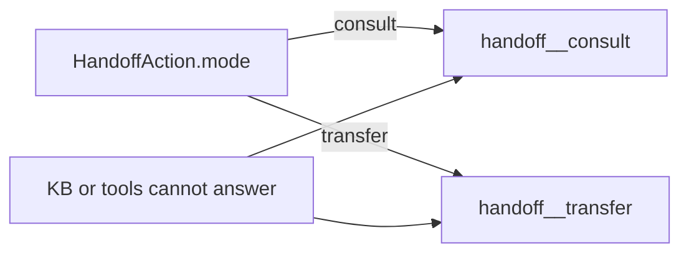

# Handoff Action (`jvagent/handoff_action`)

One mode at a time, selected by `HandoffAction.mode`. That mode is the only
tool set published. Pin those same tools on the orchestrator. Put allow and
deny rules only for that mode's tools (none for transfer). There is no handoff
skill.

The action is **agent-agnostic**: its routing and tool text names no
agent-specific skill, product, or domain concept. The routing text says "the
fallback skill"; the agent supplies its own fallback through its skill list and
orchestration parameters. Do not add agent-specific code or skill names here.

| Mode | Pin these tools | What it does |
|---|---|---|
| `consult` (default) | `handoff__consult`, `handoff__save_answer`, `handoff__update_chunk` | Ask staff, tell the user you will return, save the answer, and reply to the user. On web/default the first call only asks for a contact; a completed consult creates one pending row. The current pending questions are injected into the staff-turn prompt as a parameter (id + question only) — no read tool. `handoff__save_answer` reports delivered/skipped/failed; never claim a notification that did not happen. |
| `transfer` | `handoff__transfer` | Send staff a summary and tell the user a staff member will follow up; later messages run normally. On web/default the first call asks for one contact and the next call with it sends; on WhatsApp the sender is the contact. No pending row and no save tool. |
| `observe` | `handoff__observe` | In a WhatsApp group, store a reusable fact in PageIndex, add the other numbers to staff, and **send nothing**. |

## When the owning skill cannot answer

After a skill (for example `faq` or `product_search`) follows its search
protocol and still has no grounded answer, escalate using **the handoff tool
for the agent's configured mode**:

- **consult** → `handoff__consult` (customer's words in `message` sentence 1)
- **transfer** → `handoff__transfer` (short staff summary in `message`)

The orchestrator **auto routing** rule (below) uses the same trigger for
consult and transfer customers: *the owning skill or tool ran and the answer
is not in this turn's tool results*. Agent skills must **not** contradict that
(for example "do not hand off on empty FAQ" on a transfer agent). Prefer
**mode-neutral** skill wording ([Skill templates](#skill-templates)) so you
can switch modes in yaml only.



## Mode switch checklist

Change **all** of these when switching mode (pins and permissions do not
follow `mode` by themselves):

1. `HandoffAction.mode` → `consult` | `transfer` | `observe`
2. Orchestrator `pinned_tools` → that mode's tool list only (remove stale pins)
3. Remove the **previous** mode's `permissions.<channel>.tools` entries
4. Add the **new** mode's permissions map (consult matrix, transfer none, observe staff allow)
5. `handoff_channels` → use key `consult` or `transfer` matching mode (observe typically omits notify)
6. Search the agent for `handoff__` and update every hit: **skills** and any
   **agent `parameters`** that name a handoff tool. Agent-tier parameters
   outrank the action's auto rule, so a stale `handoff__consult` there wins even
   after the mode changes. Use the [skill templates](#skill-templates) to keep
   wording mode-neutral.
7. Consult-only `handoff.contact_declined`: add it for consult; remove it for
   transfer (the transfer tool has no such argument).
8. Add the mode's repeat/thanks rule and update `routing.faq_fallback` /
   `routing.handoff_required` to the mode's tool. Transfer: see
   [Playbook: transfer](#playbook-transfer). Consult: see
   [Playbook: consult](#playbook-consult).
9. Update the agent README, CHANGELOG, and test guide that state the mode.
10. Apply with a **source** update (`jvagent --update --source --yes`) and
    restart. A plain merge update can leave the old action context in the
    database.
11. **Smoke test** — empty FAQ, B2B escalation, staff answer (consult only), and
    the new mode's failure path. For transfer, use one user/session with a
    completed transfer, a repeat, a contact restatement, and a new intent.

**A stale pin is silent.** `pinned_tools` matches published tool names only; a
name the active mode does not publish is ignored. With lean surfacing
(`lean_tool_threshold` / `lean_presurface_k`) the new mode's tool can then be
absent from the turn prompt, so update pins before the skills.

## Common setup (all modes)

1. Add `jvagent/handoff_action` with `enabled: true`.
2. Populate `user_groups.HandoffAction.staff` on `jvagent/access_control_action`.
3. For **consult** or **transfer**, set `customer_contact: phone` | `email` for web/default.
4. Omit `parameters` on HandoffAction unless you intentionally override auto routing.
5. Pin **only** the active mode's tools on `jvagent/orchestrator`.

## Auto routing (no `parameters` block)

Leave `parameters` empty on the handoff action. Each turn the orchestrator
pools action parameters; HandoffAction supplies orchestration rule(s) from
**mode** and whether the **sender** is in `HandoffAction.staff`.

Handoff tools are **not** behind a skill. When an auto rule's condition
matches, it **overrides** the active skill and any skill procedure.

| Mode | Sender | Key | Condition (verbatim) | Response (summary) |
|---|---|---|---|---|
| consult | customer | `handoff_consult` | the owning skill or tool ran and the answer is not in this turn's tool results | Route unowned requests to the agent's fallback skill first; call `handoff__consult` if it still cannot answer or complete; relay only the tool line; sentence 1 = customer's words; contact rules per channel |
| consult | staff | `handoff_consult_staff` | (unconditional; injected only for staff) | Staff-turn parameter carries `PENDING QUESTIONS: [{"id","question"}]`; save against every id the text settles (group only same-topic/rephrase); `handoff__save_answer` reports delivered/skipped/failed — never claim notified unless delivered; `handoff__update_chunk` only for a `Handoff chunk` `n.DocumentNode.` id |
| transfer | customer | `handoff_transfer` | *(same condition as consult customer)* | Route unowned requests to the fallback skill first; call `handoff__transfer` with a short summary; relay only the tool line; keep helping on later turns; a contact refusal ends the ask path (no second ask); an error gets a brief apology, never a false confirmation; no second transfer for a confirmation, thanks, or a restatement. An agent-tier `routing.handoff_closed` rule can extend this to repeats with no new intent/detail (see the transfer playbook). |
| transfer | staff | `handoff_transfer_staff` | (unconditional; injected only for staff) | Staff turns are not customer turns: no customer skill, no customer-facing text, no transfer for a message needing no escalation; reply only to a staff question |
| observe | any | `handoff_observe` | the latest WhatsApp group message states a reusable fact, policy, decision, or answer | Call `handoff__observe` with one self-contained sentence per fact; do not reply or send anything to the group; no customer skill; store nothing for a question, greeting, thanks, chatter, or a fact already stored |

**Override:** a non-empty `parameters` list on the action in agent.yaml
**replaces** auto rules entirely. Use for custom agents or narrow transfer
behavior — see [Parameters override](#parameters-override).

The staff consult rule applies on every staff turn and lists the current
unanswered questions in the parameter; the model matches the staff message to
those ids. The core staff rule owns staff turns — do **not** duplicate it in an
agent-tier parameter with a different key; both would render and the agent copy
would win.

## Skills vs handoff (rules of thumb)

- The orchestrator loop prefers **skills first** (`use_skill` before ad-hoc tools).
- FAQ is for customer **questions** answered from PageIndex, not staff **statements** or saves.
- Do **not** put `handoff__save_answer`, `handoff__update_chunk`, or
  "call handoff in FAQ description" in FAQ skills — that makes FAQ match staff
  turns and the model opens with `use_skill` before handoff routing.
- Use FAQ **Do not use when** / description so staff answers do **not** activate faq.
- When KB/tools cannot answer, call the mode's customer handoff tool; do not
  promise staff follow-up in prose instead of the tool when the auto rule applies.

## Updating agent skills when HandoffAction mode changes

**Goal:** Use **mode-neutral** skill text so switching consult ↔ transfer
requires only the [mode switch checklist](#mode-switch-checklist) and no skill
edits. Use mode-specific snippets only if the agent will never change mode.

A mode-neutral skill names the outcome, not the tool: "call the handoff tool for
this agent's mode and relay only the line it returns". A mode-specific skill
names the tool **and** matches its relay: consult says the team is checking,
transfer says the request was passed to the team.

### What to change in skills

| Location | consult | transfer | observe (customer-facing skills) |
|----------|---------|----------|----------------------------------|
| Tool in procedures | `handoff__consult` | `handoff__transfer` | Do not reference customer handoff tools |
| `message` semantics | Customer's words, short (sentence 1) | Short staff summary | N/A |
| Empty KB / weak catalog | Call consult; relay tool line only | Call transfer; relay tool line only | N/A |
| After handoff | User waits for staff save + async reply | Continue helping on later messages | N/A |
| `allowed-tools` in skill frontmatter | Orchestrator pins handoff; listing optional | Same | Same |

### Skills that typically need handoff lines

| Skill | Where to patch |
|-------|----------------|
| `faq` | Step **EMPTY RESULT** / unscoped search empty |
| `product_search` | **Weak or empty results** |
| `salesmanship` | **Escalation triggers** / B2B row |
| `fab` | FAB doc gap / out of scope |
| `pageindex_with_links` | **Fallback response** |

### Mode-specific find/replace (if not using mode-neutral text)

**Permanently on consult:** replace `handoff__transfer` → `handoff__consult`;
remove "continue helping after handoff"; ensure empty KB calls consult, not prose.

**Permanently on transfer:** replace `handoff__consult` → `handoff__transfer`;
replace "checking with the team" with "passed to the team"; replace "will get
back to you" with "a staff member will follow up"; remove every mention of
`handoff__save_answer` / `handoff__update_chunk` and any "wait for the answer"
step; add "after transfer, keep helping when you can"; ensure empty KB calls
transfer; keep "do not promise a staff follow-up before the tool returns."
Use the exact snippets in the [transfer playbook](#playbook-transfer).

### Skill mistakes to avoid

- Hardcoding one tool name while yaml sets another mode.
- "Do not auto handoff on empty FAQ" on an agent whose mode expects KB-gap escalation.
- Staff tools in FAQ skill text → wrong routing on staff messages.
- `reply` with "a team member can confirm…" when the orchestration rule requires the handoff tool.
- Stale tool names in skill **description** / frontmatter.

### After skill edits

```bash
# Example: wrong tool names for current mode
rg 'handoff__consult|handoff__transfer' agents/<your-agent>/skills/
```

Re-run smoke: empty FAQ → correct tool; B2B → handoff; staff save (consult only).

## Skill templates

For an agent that is **permanently transfer**, use the transfer-specific snippets
in the [transfer playbook](#playbook-transfer) instead. The templates below are
mode-neutral and are for agents that may switch modes.

Copy into agent `SKILL.md` files (mode-neutral — works with consult or transfer yaml).

**FAQ — EMPTY RESULT (after search protocol, no usable hits):**

```markdown
Do not invent an answer. Call `handoff__consult` or `handoff__transfer`
according to this agent's HandoffAction mode (see OPERATING RULES for
`message`, contact, and relay). Relay only the tool return line; omit
`contact` on WhatsApp. Do not substitute prose (for example "a team member
can confirm") when the handoff orchestration rule applies.
```

**product_search — weak or empty (after optional `faq` if applicable):**

```markdown
If you still cannot answer from catalog and FAQ, do not invent products.
Call `handoff__consult` or `handoff__transfer` per HandoffAction mode and
OPERATING RULES; relay only the tool line.
```

**salesmanship — escalation:**

```markdown
When escalation applies, call `handoff__consult` or `handoff__transfer` per
HandoffAction mode with the appropriate `message` (customer words vs staff
summary). Relay only the tool line. After transfer, keep helping on later
messages when you can (transfer mode only).
```

**fab / pageindex — knowledge gap:**

```markdown
If search cannot ground an answer, do not invent detail. Call
`handoff__consult` or `handoff__transfer` per HandoffAction mode when the
orchestration rule applies.
```

Reference implementation: **Silvie** (`agents/silvie-ai/agents/silvies/silvie_ai`)
was the **transfer** validation example and has since returned to **consult**.
It used mode-specific skill wording (`handoff__transfer`), a `faq` fallback, and
an agent-tier `routing.handoff_closed` repeat/contact rule. Use the transfer
playbook above as the guide, not the snapshot; for an agent that must switch
modes, use the mode-neutral templates. The action itself contains no
agent-specific code.

## Parameters override

A non-empty `parameters` list on `jvagent/handoff_action` **replaces** all
auto rules from mode. Use when an agent needs custom escalation logic without
changing jvagent code.

**Example — transfer with explicit-escalation only (no KB-gap auto transfer):**

```yaml
- action: jvagent/handoff_action
  context:
    enabled: true
    mode: transfer
    handoff_channels:
      transfer: whatsapp
    parameters:
      - scope: orchestration
        key: handoff_transfer_explicit
        condition: >-
          the user wants a person or wants something reported, and the
          conversation should move to staff
        response: >-
          Call handoff__transfer with a short summary. Do not reply in text.
          Relay only the tool line. Omit contact on WhatsApp. On later
          messages keep helping when you can.
```

Skills for such an agent should **not** require handoff on empty FAQ alone.

## Staff numbers and emails

Put every staff WhatsApp number and email in one list:
`user_groups.HandoffAction.staff` on `jvagent/access_control_action`.

```yaml
- action: jvagent/access_control_action
  context:
    user_groups:
      HandoffAction:
        staff:
          - "5926178650"        # WhatsApp number
          - "team@example.com"  # email
```

- **WhatsApp** (`handoff_channels` value `whatsapp`) — one staff number from
  the list is chosen at random per notification.
- **Email** (`handoff_channels` value `email`) — the first email is the
  recipient; the rest are CC'd.

**Customer contact** (`customer_contact`: `phone` | `email`) — which single
type to collect on web/default. On web, the first handoff call with no
resolved contact relays intro plus contact ask and does **not** notify staff;
the user's reply is passed as `contact` on the next tool call. WhatsApp
customers use the sender id automatically.

## Playbook: consult

**Use when** staff must answer into PageIndex and the customer gets an async
reply when staff saves.

**Not for** notify-and-continue-only workflows (use **transfer**) or silent fact
capture (use **observe**).

### Setup

- `mode: consult`, `handoff_channels.consult: whatsapp` | `email`.
- `customer_contact: phone` | `email` for web/default. WhatsApp uses the sender;
  a group turn uses the participant or the group chat id.
- Pin three tools: `handoff__consult`, `handoff__save_answer`,
  `handoff__update_chunk`.
- Permissions on **every channel** (`default`, `whatsapp`, …): customers →
  `handoff__consult` only; staff → save/update only.
- Staff group: `user_groups.HandoffAction.staff`.
- Remove transfer pins/permissions; update agent-tier parameters that name a
  handoff tool to `handoff__consult`; add the consult-only
  `handoff.contact_declined` rule; remove a transfer-only `routing.handoff_closed`
  or rewrite it for consult.
- Apply with a **source** update (`jvagent --update --source --yes`) and restart.

```yaml
- action: jvagent/orchestrator
  context:
    pinned_tools:
      - handoff__consult
      - handoff__save_answer
      - handoff__update_chunk

- action: jvagent/handoff_action
  context:
    enabled: true
    mode: consult
    customer_contact: phone
    handoff_channels:
      consult: whatsapp
```

Permissions (repeat under each channel):

```yaml
permissions:
  default:
    tools:
      handoff__consult:
        deny: [{ group: staff, enabled: true }]
        allow: [{ group: all, enabled: true }]
      handoff__save_answer:
        deny: []
        allow: [{ group: staff, enabled: true }]
      handoff__update_chunk:
        deny: []
        allow: [{ group: staff, enabled: true }]
  whatsapp:
    tools:
      # same three-tool matrix
```

### Customer flow

- `message`: sentence 1 restates the customer's request in their own words as a
  complete, self-contained sentence — never a keyword, product name alone, or
  topic label; optional sentence 2 says what was already tried. On a contact
  follow-up, sentence 1 is identical; only the contact changes.
1. **Web/default, first call with no contact** → the tool returns the intro plus
   contact ask; it does **not** create a pending row and does **not** notify
   staff. It records that the ask happened for the next turn.
2. **Customer supplies the contact** → call again with the same `message` and
   `contact`. This creates **one** pending row, notifies staff, and returns the
   "checking with the team" line.
3. **Customer refuses after the ask** → call again with the same `message` and
   `contact_declined: true` (never on the same turn as the ask). This creates a
   pending row with `user_contact="declined"`, notifies staff, and asks for no
   second contact.
4. **WhatsApp** → the sender (or group author) is the contact; omit `contact`;
   one call creates the pending and notifies staff.
5. **Contact follow-up** → repeat sentence 1 exactly as the first consult; only
   the contact changes. Never pass placeholders.
6. **After completion** → a confirmation, thanks, contact restatement, or a
   repeat of the same request with no new intent/detail creates **no** new
   pending. Only a new, different request may create one.
7. Never write a holding or follow-up promise before the tool returns; relay
   only the tool line.

Agent-tier rule for the repeat/thanks case (name `handoff__consult`):

```yaml
- key: routing.handoff_closed
  scope: orchestration
  tier: agent
  response: >-
    Before calling handoff__consult, check the earlier messages. If the request
    was already sent to staff and the customer is only confirming, thanking,
    restating the contact, or repeating the same request with no new intent or
    detail, do not call handoff__consult again; reply briefly. A new, different
    request may hand off.
```

Agent-tier rule for a refused contact (consult-only):

```yaml
- key: handoff.contact_declined
  scope: orchestration
  tier: agent
  response: >-
    On web or default, if the customer refuses the contact handoff__consult
    asked for in an earlier turn, call handoff__consult again with the same
    message and contact_declined: true so the request still reaches staff.
    Never on the same turn as the ask, and never when the contact is simply
    unknown. Do not ask a second time.
```

### Customer relay

The acknowledgment is generated from model-facing steering (topic echo +
check-with-team + reply-on-response); the model voices a fresh line per request.
Setting `handoff_intro` and/or `consult_close` in `agent.yaml` forces a
deterministic literal relay instead (the old intro + close behavior). Relay only
the tool line; never paste the tool text.

### Skill wording (permanent consult agent)

A permanent consult agent should name `handoff__consult` directly. Use
"checking with the team" / "will get back to you" wording, not the transfer
"passed to the team" wording. Never name `handoff__transfer`,
`handoff__save_answer`, or `handoff__update_chunk` in a customer-facing skill.

**FAQ — no usable hit:**

```markdown
If the search returns nothing usable, do not guess and do not search again.
Call `handoff__consult` and wait for its result. Do not write that you are
checking with the team before the call returns; relay the line it returns in
one or two short sentences. Omit `contact` on WhatsApp. If the result is an
error, apologize briefly and do not claim staff were notified.
```

**product_search — weak or empty:**

```markdown
If the catalogue cannot answer, do not invent a product or stock value. Call
`handoff__consult` per the orchestration rule, relay only the tool line, and
keep helping with anything else in the meantime.
```

**salesmanship — escalation / discount / B2B:**

```markdown
When a quote, discount, credit, delivery, warranty, or B2B request needs a
person, call `handoff__consult` with the customer's request in `message`.
The result tells you what to say: voice it as one or two short sentences that
acknowledge the request and say you are checking with the team. Never paste the
tool text. Do not promise a follow-up before the tool returns.
```

**fab / pageindex — knowledge gap:**

```markdown
If the source cannot ground the answer, do not invent detail. Call
`handoff__consult` when the orchestration rule applies and relay only the tool
line. Keep helping with anything else in the meantime.
```

### Staff flow

- The core consult staff rule owns staff turns; do **not** duplicate it in an
  agent-tier parameter with a different key.
- The staff parameter carries `PENDING QUESTIONS: [{"id","question"}]`; ids start
  with `pend_`. Match the staff text to every id it settles — a next step or
  policy settles every ask of that kind; group only same-topic or clear
  rephrases; different topics save only their ids. A perfect match is not
  required.
- Call `handoff__save_answer` with those ids and the full staff text. A prior
  save for the same subject does not cover a new `pend_` id; save each new id.
- A declined or missing contact is still a pending question: save the answer;
  the tool reports skipped delivery. Do not reply “Noted.” instead of calling
  the tool.
- Same topic is not the same request: a price for one quantity/model does not
  settle a different quantity/model or another pending request unless the staff
  text says it applies to both.
- When the pending list is empty, say there is no pending question; never say
  saved. Never claim a save without a tool result.
- `handoff__update_chunk` is only for an `[EVENT] Handoff chunk` line and its
  `n.DocumentNode.` id. A `corr-` id is neither.
- Reply in the staff thread only when staff asks a question; send nothing for
  thanks, “ok”, or a no-content message, and do not save then.
- A denied save/update call: say nothing about permissions.
- Staff identity resolves from `HandoffAction.staff`, including group authors and
  normalized phone/JID forms.

### Delivery truth

`handoff__save_answer` returns a directive based on delivery:

- **delivered** → “the answer is saved and the customer has been notified.”
- **skipped** (no contact or `declined`) → “the answer is saved, but the customer
  has no contact on file, so they were not notified.” The pending row is
  resolved (no longer pending).
- **mixed** → “saved and sent to N customer(s); M had no contact on file and were
  not notified.”
- **failed** → “partial failure: the answer was saved, but delivery failed for
  …; keep those `pend_` ids and retry delivery.” The row stays with
  `delivery_status=failed`.

Never say the customer was notified unless the result says **delivered**. The
customer message (when delivered) thanks them, reminds them of the question,
then gives the answer. Multiple pending rows for the same contact get **one**
customer message; the extra rows resolve without a second send.

`handoff__update_chunk` does **not** deliver to the customer; it updates the
stored answer for one chunk and returns “your answer is updated.”

### Pending lifecycle

- No row on the first contact-ask turn.
- One row per completed consult (contact supplied or declined); `user_contact`
  stores the phone/email or `declined`.
- Staff save resolves the row: delivered/skipped marks it resolved; failed keeps
  it pending with `delivery_status=failed` for retry.
- `pend_` ids identify pending rows; `n.DocumentNode.` ids identify chunks;
  `corr-` ids are neither.
- A repeat, thanks, contact restatement, or confirmation after completion creates
  no second row.

**DB evidence:** a completed consult has one pending row (status pending, then
resolved or failed), a `Handoff started` event, and on save a `Handoff delivered
the saved answer to the customer` event when delivery succeeded. A chunk update
records a chunk event and does not deliver to the customer.

### Smoke tests

1. First web/default call with no contact → ask; **0** pending rows; **no** staff
   notify.
2. Contact supplied → **1** pending row; staff notify; customer acknowledgment.
3. Contact refused after the ask → row with `declined`; staff notified; save
   reports saved-but-not-notified; no customer message.
4. Staff answer with a contact → customer receives thanks + question + answer;
   staff confirmation says notified.
5. Staff answer with no contact/declined → saved, not delivered; staff told.
6. Delivery failure → partial failure; id retained for retry; no false claim.
7. `thanks` / contact restatement / repeat after completion → no second pending.
7b. A second pending on the same subject after a prior save → still calls
    `handoff__save_answer` for the new `pend_` id; a prior save is not a
    substitute.
7c. Same topic, different quantities → only the ids the staff text actually
    settles; a price for one quantity is not a price for another.
7d. Declined/missing contact → still calls `handoff__save_answer`; the tool
    reports skipped delivery, not a false save.
8. Staff question back → staff-thread reply, no save; staff thanks → no save, no
   customer text.
9. `handoff__update_chunk` with a `n.DocumentNode.` id → stored; a `corr-` id is
   rejected; no customer delivery.
10. Empty KB → consult; search error → apologize, no false notification.
11. End state: no pending rows after resolution; no `handoff__transfer` calls; no
    false “notified” claim.

### Portable checklist

- [ ] `mode: consult`; correct `handoff_channels`; `customer_contact` set.
- [ ] Orchestrator pins `handoff__consult`, `handoff__save_answer`,
      `handoff__update_chunk`.
- [ ] Customer/staff permission matrix on every channel; staff group populated.
- [ ] `handoff.contact_declined` present; transfer-only parameters removed.
- [ ] `routing.faq_fallback` / `routing.handoff_required` name consult.
- [ ] `routing.handoff_closed` has the consult repeat/thanks rule.
- [ ] Skills name `handoff__consult`; no transfer-only wording.
- [ ] Agent README, CHANGELOG, and interaction guide updated.
- [ ] Source update + restart.
- [ ] Smoke test covers ask, contact, decline, delivery, skipped, failed, repeat,
      staff question, chunk update, and 0 pending rows.

## Playbook: transfer

**Use when** staff should be notified per issue and the bot keeps helping on later
customer messages.

**Not for** staff-ingest + auto-reply (use **consult**) or silent fact capture
(use **observe**).

### Setup

- `mode: transfer`, `handoff_channels.transfer: whatsapp` | `email`.
- `customer_contact: phone` | `email` for web/default. WhatsApp uses the sender;
  a group turn uses the participant or the group chat id.
- Pin **only** `handoff__transfer`.
- **No** `permissions.*.tools` entries for handoff. The staff list is still used
  for notify targets.
- Remove every consult pin and permission (`handoff__consult`,
  `handoff__save_answer`, `handoff__update_chunk`).
- Remove the consult-only `handoff.contact_declined` parameter. Transfer has no
  such argument; a stale rule makes the model call a parameter the tool does not
  accept.
- `message`: sentence 1 is the customer's request as a self-contained sentence;
  optional sentence 2 is what was already tried (staff-only). Never a keyword,
  topic label, or “Customer wants…” summary.
- Apply with a **source** update (`jvagent --update --source --yes`) and
  restart. A plain merge update can leave the old action context in the database.

```yaml
- action: jvagent/orchestrator
  context:
    pinned_tools:
      - handoff__transfer

- action: jvagent/handoff_action
  context:
    enabled: true
    mode: transfer
    customer_contact: phone
    handoff_channels:
      transfer: whatsapp
```

### Agent-tier parameters (recommended)

These are prompt rules, not action config. They outrank the core auto rule, so a
stale `handoff__consult` here survives a mode switch.

- `routing.faq_fallback` and `routing.handoff_required`: name
  `handoff__transfer`; call it after the owning skill returns no usable answer,
  before writing anything. Never write "passed to the team" or "a staff member
  will follow up" before the tool returns.
- `routing.handoff_closed`: check the earlier messages. A message that repeats a
  request already sent to staff and adds no new intent, subject, quantity,
  model, or other detail — same words, typo, spelling/dialect variant, rephrase,
  or a bare contact restatement — is not a new request: reply briefly that it was
  already transferred and a staff member will follow up; do not call the tool.
  A new intent or detail (discount, price negotiation, delivery, warranty,
  service, complaint, a different model or quantity) is a new request: transfer
  it. A confirmation or thanks never transfers. If the contact was already
  provided, use it and do not ask again.
- Remove `handoff.contact_declined`; it is consult-only.

```yaml
- key: routing.handoff_closed
  scope: orchestration
  tier: agent
  response: >-
    Before calling handoff__transfer, check the earlier messages in this
    conversation. If the customer's current message repeats a request already
    sent to staff and adds no new intent, subject, quantity, model, or other
    detail — same words, a typo, a spelling or dialect variant, a rephrase, or a
    bare contact restatement — do not transfer: reply briefly that it was already
    transferred and a staff member will follow up. If it adds a new intent or
    detail, treat it as a new request and transfer it. A confirmation or thanks
    never transfers; if the contact was already provided, use it without asking
    again.
```

**Model caveat.** This dedupe is prompt-level. A small model can ignore it even
when the rule and the earlier messages are in context (confirmed live on
Silvie). Always test one user/session with: a completed transfer, a typo repeat,
a bare contact restatement, and a new intent about the same product (e.g. a
discount). If the model still duplicates or over-dedupes, the remaining lever is
model capability; more prose alone is unlikely to hold.

### Skill wording (permanent transfer agent)

A permanent transfer agent should name `handoff__transfer` directly. Replace
consult language:

| Consult wording | Transfer wording |
|---|---|
| "checking with the team" | "passed to the team" |
| "will get back to you" | "a staff member will follow up" |
| "do not promise a person in text" | "do not promise a staff follow-up before the tool returns" |
| "wait for the answer" | "keep helping on later messages" |

Rules:

- Never name `handoff__save_answer` or `handoff__update_chunk`; transfer has no
  save path and no pending question.
- Empty KB / weak catalogue → `handoff__transfer`, relay only the tool line;
  never substitute prose.
- If the customer already gave a contact, use it; do not ask a second time.
- After a transfer, keep helping with later requests.

**FAQ — no usable hit:**

```markdown
If the search returns nothing usable, do not guess and do not search again.
Call `handoff__transfer` and wait for its result. Do not write that the request
is with the team before the call returns; relay the line it returns in one or
two short sentences. Omit `contact` on WhatsApp. If the result is an error,
apologize briefly and do not claim staff were notified.
```

**product_search — weak or empty:**

```markdown
If the catalogue cannot answer, do not invent a product or stock value. Call
`handoff__transfer` per the orchestration rule, relay only the tool line, and
keep helping on later messages.
```

**salesmanship — escalation / discount / B2B:**

```markdown
When a quote, discount, credit, delivery, warranty, or B2B request needs a
person, call `handoff__transfer` with the customer's request in `message`.
The result tells you what to say: voice it as one or two short sentences that
acknowledge the request and say it has been passed to the team. Never paste the
tool text. Do not promise a staff follow-up before the tool returns.
```

**fab / pageindex — knowledge gap:**

```markdown
If the source cannot ground the answer, do not invent detail. Call
`handoff__transfer` when the orchestration rule applies and relay only the tool
line. Keep helping on later messages.
```

### Contact flow

- **Web/default:** the first call with no contact returns the ask line and does
  **not** notify staff. The next call with the contact sends the summary. On
  later requests the tool reuses the saved `handoff_contact`; the model may not
  see the number, so do not rely on it remembering the digits.
- **WhatsApp:** the sender (or group author) is the contact; omit `contact`.
- **Refusal:** say the team needs a contact to follow up, keep helping, and do
  not ask a second time. Transfer has no pending record, so a refusal cannot be
  escalated; use consult if escalation without a contact is required.

### Staff behavior

- Staff receive one summary per issue: the request plus the contact.
- A staff turn is not a customer turn: no customer skill, no customer-facing
  text, no transfer for a message that needs no escalation.
- Reply in the staff thread only when staff asks a question; otherwise send
  nothing.
- There is no `PENDING QUESTIONS` block, no `handoff__save_answer`, and no
  `handoff__update_chunk` in transfer mode.
- **After a consult→transfer switch,** a staff thread that already contains
  consult saves can replay “answer saved / customer notified” because the model
  sees that history. Start a fresh staff thread (or clear the staff conversation)
  before validating transfer staff turns; the core staff rule is present, but
  history can win.

**DB evidence:** a completed transfer appends `Handoff started: forwarding the
issue summary to staff` and `Handoff completed: … keep helping on later messages
only` to the interaction, and creates no `HandoffQuestion` row.

### Smoke tests

Run one user/session, not one utterance per fresh user:

1. Quote → ask contact → contact → staff summary; no pending row.
2. New request in the same session → second summary; saved contact, no re-ask.
3. Typo/rephrase repeat of an earlier request → no transfer, "already
   transferred".
4. Bare contact restatement after a transfer → no transfer.
5. New intent about the same product (discount, delivery, warranty) → **new**
   transfer.
6. `thanks` / negation / confirmation → no transfer.
7. Staff answer in a fresh thread → no save, no customer-facing text, no false
   "customer notified".
8. Staff question → staff-only reply; staff thanks → no customer text.
9. Transfer send error → brief apology; no staff-notified claim; no pending.
10. End state: `HandoffQuestion` count **0**; only `handoff__transfer` calls; no
    `handoff__consult`/`save_answer`.

Verify:

```bash
python3 "$HOME/.config/kilo/skills/jv_prompt/scripts/live_report.py" \
  --db <app> --agent <persisted-agent-id> --channel web \
  --run "<request>|<contact>|<second request>|<repeat>|<new intent>|thanks"
python3 "$HOME/.config/kilo/skills/jv_prompt/scripts/db_read.py" \
  --db <app> --entity HandoffQuestion --limit 5
```

### Portable checklist

- [ ] `mode: transfer`; correct `handoff_channels`; `customer_contact` set.
- [ ] Orchestrator pins `handoff__transfer` only.
- [ ] No handoff permissions; staff group populated.
- [ ] Consult pins, permissions, and `handoff.contact_declined` removed.
- [ ] `routing.faq_fallback` / `routing.handoff_required` name transfer.
- [ ] `routing.handoff_closed` has the repeat/no-new-intent rule.
- [ ] Skills name `handoff__transfer`; transfer wording; no save tools.
- [ ] Agent README, CHANGELOG, and interaction guide updated.
- [ ] Source update + restart.
- [ ] Same-user smoke test covers ask, saved contact, repeat, contact
      restatement, new intent, staff turn, and 0 pending rows.

### Transfer validation example (Silvie, historical)

Silvie was the transfer-mode worked example before it returned to consult. The
snapshot used during validation was:

- `agent.yaml`: `mode: transfer`, `handoff_channels.transfer: whatsapp`,
  `customer_contact: phone`; orchestrator pins only `handoff__transfer`; no
  handoff permission entries; `handoff.contact_declined` absent.
- `routing.faq_fallback` and `routing.handoff_required` named
  `handoff__transfer`; `routing.handoff_closed` held the repeat/contact rule.
- All five skills (`faq`, `product_search`, `salesmanship`, `fab`,
  `pageindex_with_links`) named `handoff__transfer`; no save/update tool text.
- Staff group: `5926178650`; one WhatsApp summary per issue.
- No `HandoffQuestion` rows are created in transfer mode.

The prompt intended a repeat with no new intent/detail to dedupe and a new
intent to transfer; verify both on the target model with the same-user smoke test
above. Do not copy this snapshot as current config — use the transfer playbook.

**Contact resolution:** provided `contact`, then saved `handoff_contact`, then
`user_id` when it matches `customer_contact` kind. On WhatsApp omit `contact`.
For **group** consults or transfers, Handoff prefers the participant phone from
`whatsapp_payload` (deep scan of nested JIDs, wwebjs `get_message_by_id` when
needed, LID→phone), then saved `handoff_contact` / `handoff_whatsapp_author`.
When no participant phone is available (after payload scan, optional
`get_message_by_id`, and saved-context fallbacks), it stores the **group chat id**
(dispatch `user_id`, e.g. `120363…`) as `user_contact`. Staff notify stays a DM to
staff; saved consult answers go back to the **group thread** (`send_message` with
`is_group=True`). Group ids are never used as a staff DM target.

`handoff__transfer` generates its completion reply from model-facing steering,
not a canned sentence; an optional contact ask is added on web when unresolved.
Optional yaml `handoff_intro` / `transfer_close` forces a fixed literal relay.

## Playbook: observe

**Use in** a WhatsApp group to capture facts silently.

**Not for** customer FAQ/catalog agents (unless a separate agent instance handles customers).

### Setup

- `mode: observe` (no customer handoff notify channel required)
- Pin **only** `handoff__observe`
- Allow `handoff__observe` for **staff** on `whatsapp`
- For a hard no-reply guarantee, deny the customer skills on the orchestrator
  (`denied_skills`) so only the observe tool can act; a prompt rule alone relies
  on the model.

```yaml
- action: jvagent/orchestrator
  context:
    pinned_tools:
      - handoff__observe
```

```yaml
- action: jvagent/handoff_action
  context:
    enabled: true
    mode: observe
```

```yaml
permissions:
  whatsapp:
    tools:
      handoff__observe:
        deny: []
        allow: [{ group: staff, enabled: true }]
```

Group messages are admitted via `whatsapp_direct_all_group_messages`. Model
sends **nothing** to the group; facts append to `handoff.md`. The tool returns a
silent marker ("do not reply or send any message"), the observe parameter says
the same, and the completion event records that no message was sent. A denied
observe call is silent too: the agent says nothing about permissions.

The condition is **reusable fact only** — a fact, policy, decision, or answer the
team will need again. A question, greeting, thanks, or chatter is not stored. The
agent must not activate a customer skill in observe mode; if it answers the group
in prose, the mode is misconfigured.

### Smoke tests

- Group message with a policy fact → `handoff__observe`, **zero** outbound group messages
- Two unrelated facts in one message → two calls; a repeated fact → no second store
- Group question or "thanks" → no store call, no reply
- No `handoff__consult` / `handoff__transfer` on customer skills for this agent

## Tool visibility and permissions

Deny is checked before allow. Repeat the `tools` block under every channel
you use. List only the **active mode's** tools.

After pins, each name under `permissions[channel].tools` is dropped when
`has_tool_access` is false. **Consult:** customers see `handoff__consult` only;
staff see save/update tools. **Transfer:** no handoff `tools` entries.
**Observe:** staff allow on `handoff__observe` only. Pin the same names you
grant; a pin the mode does not publish is silently ignored.

## Staff save confirmation and customer reply (consult only)

This path does not exist in transfer mode: transfer has no save/update tools,
no pending row, and no async customer reply.

`handoff__save_answer` returns a `Tell the user:` directive whose wording
follows the delivery status (see [Delivery truth](#delivery-truth)): delivered,
skipped (no contact/declined), mixed, or failed. The staff sender gets that
sentence; the model must not rewrite it. Never say the customer was notified
unless the tool reports **delivered**.

When delivery is **delivered**, the action sends a separate WhatsApp or email
message: thank the customer for their patience, remind them of the question,
then give the answer.

`handoff__update_chunk` updates the stored answer for one chunk and returns
“your answer is updated”; it does **not** send a customer message.

## PageIndex (consult and observe)

Transfer writes nothing to PageIndex. Saved answers and observed facts go to
`doc_name="handoff.md"`, `metadata={"access": "public"}`.

Notify delivery uses `handoff_notify_action_type` (default `WhatsAppAction`)
or `handoff_email_action_type` (default `EmailAction`).

## License

See the application-level [LICENSE](../../../../LICENSE).

## Author

**Tharick Jairam** · jvagent/handoff_action / V75 Inc.
